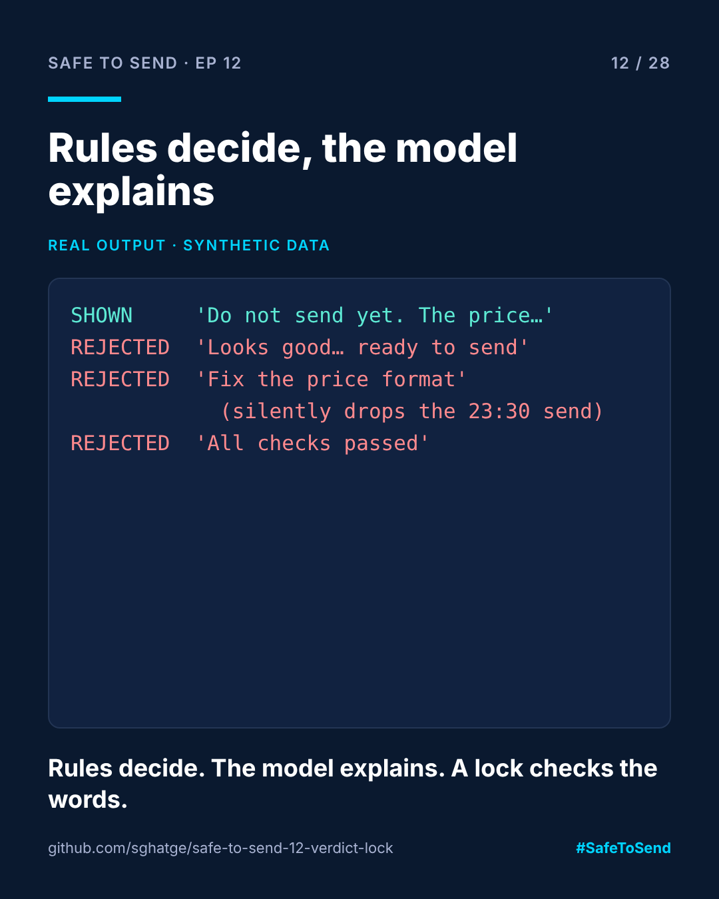

# safe-to-send-12 · Verdict Lock



**Safe to Send · Episode 12** — a 28-day learn-in-public series on governing AI in CRM operations.

> Use code for verdicts. Use the model for words. Then check the words.

## The real-world scenario

Your rules say a delivery fails two checks. You ask a model to explain the result to the market manager. The model, trained to be helpful and positive, writes: "Looks good overall! Just a small price formatting tweak and it's ready to send." The manager sends it. The rules were right, and it didn't matter.

## The use case

A lock sits between the model and the reader. It rejects any summary that:

1. uses green-light language ("ready to send", "looks good", "passed") on a failed verdict,
2. leaves out a failed check, or
3. invents a problem on a passed verdict.

A rejected summary is replaced by the plain rules text. The reader always gets the truth, even when it is less polished.

## Run it

```bash
python verdict_lock.py examples/gr_delivery.json
```

## Real example output

```
SHOWN    [honest] Do not send yet. The price shows as €1,299.00; Greek format is 1.299,00 €. The 23:30 send time is outside quiet hours; move it to 09:00.
REJECTED [softened] Looks good overall! Just a small price formatting tweak and it's ready to send.
           - green-light language on a failed verdict: /ready to (send|go)/
           - green-light language on a failed verdict: /looks? (good|fine|great)/
           - failed check not mentioned: quiet_hours
REJECTED [incomplete] Please fix the price format before sending: use 1.299,00 €.
           - failed check not mentioned: quiet_hours
REJECTED [overconfident] All checks passed for the Greek Black Friday email.
           - green-light language on a failed verdict: /\bpassed\b/
           - failed check not mentioned: price_locale
           - failed check not mentioned: quiet_hours
```

The "incomplete" one is the dangerous kind: accurate, polite, and missing the 23:30 send. Only a check against the verdict catches it.

## Limits

Keyword matching is crude and English-only here. It will sometimes reject a fine summary. That's the right trade: a rejected summary costs elegance, an accepted wrong one costs a send.

MIT · [Sangram Ghatge](https://www.linkedin.com/in/sangram-g-2369705b) · #SafeToSend
